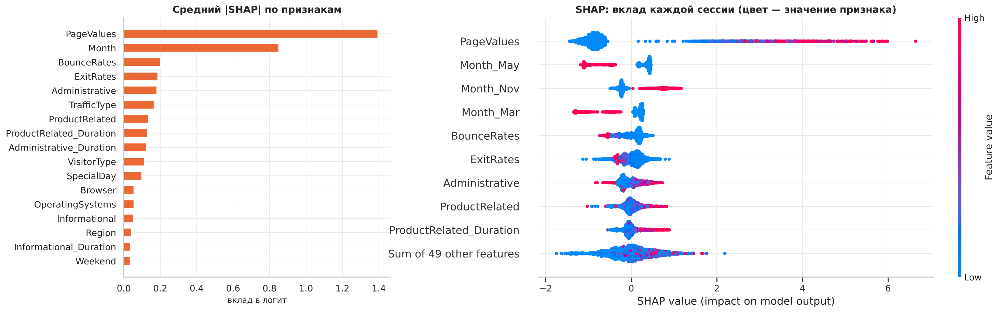

# Прогноз покупки по сессии интернет-магазина: EDA → CatBoost → дашборд в Docker

<!-- header -->
<p align="center">
  
  
  
  
  
  
</p>

<p align="center"></p>

Сквозной проект по CRISP-DM на открытых данных: разведочный анализ, подготовка признаков, сравнение моделей
классификации, интерпретация через SHAP и интерактивный дашборд, который поднимается одной командой.

## Задача и данные

По 17 признакам сессии (просмотры страниц разных типов и время на них, метрики Google Analytics, месяц, тип посетителя)
предсказать, закончится ли сессия покупкой. Датасет
[Online Shoppers Purchasing Intention](https://archive.ics.uci.edu/dataset/468/online+shoppers+purchasing+intention+dataset)
(UCI, id 468): 12 330 сессий, покупкой заканчиваются 15,5 %.

## Результат

**CatBoost на тестовой выборке: ROC-AUC = 0,929, PR-AUC = 0,744 (у случайной модели PR-AUC = 0,155).**

* При пороге 0,27, подобранном по F1 на out-of-fold прогнозах обучающей выборки, модель находит 286 из 382 покупок
  (recall 0,75) при precision 0,61.
* Модели сравнивались на кросс-валидации и отложенном тесте: kNN, логистическая регрессия (с весами классов и со SMOTE),
  решающее дерево, случайный лес, SVM, CatBoost.
* Главный вклад в прогноз по SHAP даёт `PageValues`, затем `Month`, `BounceRates`, `ExitRates`, `Administrative`,
  `TrafficType`. Без `PageValues` качество падает до ROC-AUC 0,765 и PR-AUC 0,355: модель во многом опирается на метрику
  Google Analytics, связанную с историей транзакций.
* EDA: ненулевой `PageValues` есть у 80,6 % сессий с покупкой и только у 11,4 % сессий без неё; найдено 125 полных
  дубликатов, номинальные коды (`Browser`, `Region`, `TrafficType` и др.) отделены от числовых признаков.
* Дашборд на ExplainerDashboard с собственными вкладками EDA: 7 вкладок, сборка и запуск — `docker compose up --build`.

## Что внутри

| Работа | Этап CRISP-DM | Что сделано |
|---|---|---|
| [lab2](lab2_eda_overview/lab2_eda_overview.ipynb) | понимание задачи и данных | типы, пропуски, дубликаты, целевая переменная, признаки в разрезе классов |
| [lab3](lab3_correlations/lab3_correlations.ipynb) | понимание данных | Пирсон, Спирмен, Кендалл, V Крамера, η, φK, мультиколлинеарность, пары факторов |
| [lab4](lab4_features/lab4_features.ipynb) | подготовка данных | кодирование, редкие категории, `log1p`, масштабирование, выбросы, VIF и проверка на моделях |
| [lab5](lab5_models/lab5_models.ipynb) | моделирование и оценка | 7 моделей, порог, калибровка, перестановочная важность, SHAP, разбор отдельных прогнозов |
| [lab6](lab6_dashboard/) | развёртывание | дашборд в Docker |
| [Проект](project/project.ipynb) | всё вместе | связный итоговый отчёт и [презентация](project/presentation/project_presentation.pdf) |
| [lab1](lab1_katatonia/) | подготовка данных | правила кодирования 17 признаков клинического датасета и скрипт, который их реализует |
| [Практики](practices/) | EDA | датасет diamonds: дубликаты, пропуски, корреляции, ANOVA, Pandas против Polars, линейная регрессия |

Ответы на задания курса, правки кода из Colab и проверки при подготовке — в [docs/assignments.md](docs/assignments.md).

## Стек

Python 3.13 · pandas · NumPy · SciPy · scikit-learn · imbalanced-learn · CatBoost · SHAP · statsmodels · phik ·
matplotlib · seaborn · Polars · ExplainerDashboard · Dash · Plotly · Docker

## Структура и запуск

```
├── data/                  # датасеты, скачиваются scripts/download_data.py (в git не хранятся)
├── scripts/download_data.py
├── src/                   # общий код: данные, признаки, модель, стиль графиков
├── results/               # метрики и сравнение моделей из lab5 (их использует дашборд)
├── lab1_katatonia/ … lab6_dashboard/
├── project/               # project.ipynb, figures/, presentation/
├── practices/             # практики по алмазам
├── docs/assignments.md
├── docker-compose.yml
└── requirements.txt
```

Дашборд (нужны Docker с Compose и Python 3):

```bash
git clone https://github.com/Meta1rus/eda-classification.git && cd eda-classification
python3 scripts/download_data.py     # три датасета в data/, с проверкой SHA-256
docker compose up --build            # → http://localhost:9050
```

Первая сборка занимает 5–15 минут: внутри образа обучается модель и считаются SHAP-значения. Подробнее — в
[lab6_dashboard/README.md](lab6_dashboard/README.md).

Тетрадки (Python 3.13):

```bash
python -m venv venv && source venv/bin/activate
pip install -r requirements.txt
python scripts/download_data.py
jupyter lab
```

Все тетрадки сохранены с результатами, их можно просто открыть на GitHub. Полный прогон: lab2–lab4 и проект — 1–3 минуты,
lab5 — около 10 минут. Отчёт ydata-profiling для практики собирается в отдельном окружении, см.
[`practices/make_profile_report.py`](practices/make_profile_report.py). Исходный файл для lab1 — медицинские данные
от преподавателя курса, в репозиторий он не входит.

---

Выполнено в рамках курса «Разведочный анализ и алгоритмы классификации» магистратуры ПМИ ПГНИУ, 2026.
